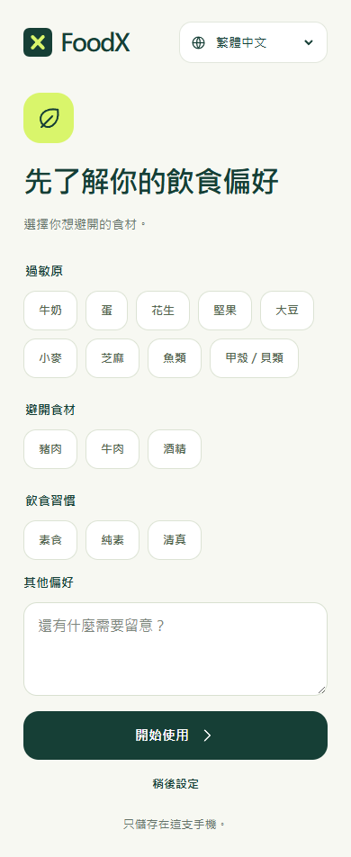
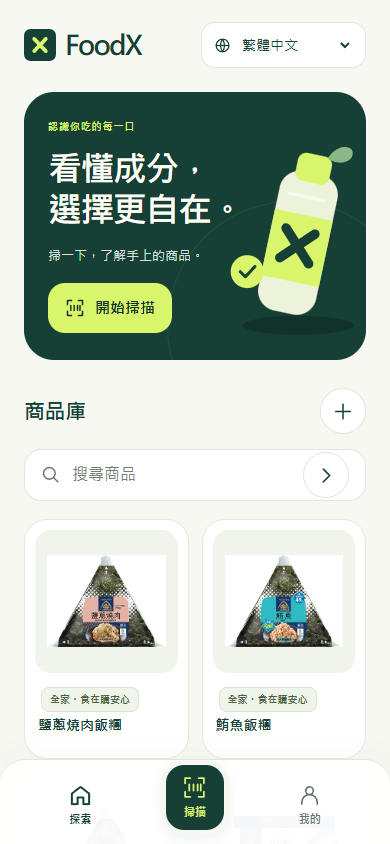
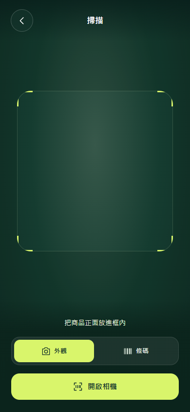
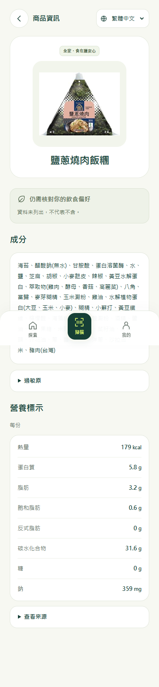

# 商品信息助手｜FoodX App 雛形展示

**團隊：Umbrella**  
**展示版本：FoodX v2.0.0**  
**展示日期：2026/10/23**

FoodX「商品信息助手」以商品掃描、成分資訊與個人飲食偏好為設計核心，協助使用者理解手上的商品。此頁提供 App 雛形介面供評審與訪客瀏覽。

> 完整商品資料庫與後台資料未公開上傳；本repo僅提供App雛形畫面，不是線上查詢服務。

## 展示範圍與版本說明

- 本頁 4 張圖片是 **2026/10/23 取得的 v2.0.0 內附 App 介面排版截圖**，用於呈現畫面與操作流程設計。
- 這些圖片 **不代表 v2.0 已完成 Android 實機功能驗證**；相機辨識、條碼掃描及資料更新的實際運作，仍須以實機測試結果為準。
- 目前 v2.0 使用 App 內附商品資料快照進行離線查詢；本頁不宣稱 Android App 已連線呼叫後台。
- 本公開專案只包含展示說明與 4 張介面圖片；不包含完整商品資料庫、後台程式、App 安裝檔或原始碼。

## 01｜首次設定：飲食偏好

呈現過敏原、避開食材、飲食習慣與其他偏好的設定介面。

## 02｜首頁：探索與搜尋商品

呈現開始掃描入口、商品搜尋與商品卡片，作為使用者進入商品資訊的起點。

## 03｜掃描：外觀與條碼入口

呈現掃描框、外觀／條碼切換與開啟相機按鈕；圖片本身不是即時相機或辨識服務。

## 04｜商品頁：成分、過敏原與營養標示

以範例商品呈現商品名稱、成分、過敏原區塊、每份營養標示與來源入口，並提醒使用者核對飲食偏好。

---

畫面中的商品圖片與文字僅作功能介面展示，相關商標與商品權利歸原權利人所有；不表示合作或背書。飲食與過敏原資訊應以商品實際包裝及最新官方標示為準，資料未列出不代表未含。
